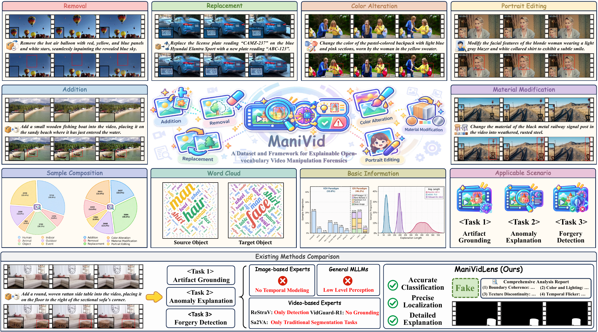

<div align="center">

# ManiVid: Unified and Explainable Forensic Analysis of Manipulated Videos

<p align="center">
   <a href="https://arxiv.org/abs/2609.30934"></a>  
</p>

</div>

## 📢 Latest News

- [2026/09/25] Our [paper](https://arxiv.org/abs/2609.30934) is available on arXiv; code, dataset, and weights are coming soon.

## 🔍 Overview

[](assets/teaser.pdf)

## Installation


## 📜 Citation

```bibtex
@article{kang2026manivid,
  title={ManiVid: Unified and Explainable Forensic Analysis of Manipulated Videos},
  author={Kang, Hengrui and Yan, Zhonghao and Yang, Yuxuan and Jing, Ruoyan and Guo, Yuncheng and Chen, Hao and Liang, Kongming and Ma, Zhanyu and He, Conghui and Li, Weijia},
  journal={arXiv preprint arXiv:2609.30934},
  year={2026}
}
```

## License

This project is released under the [Apache License 2.0](LICENSE).
